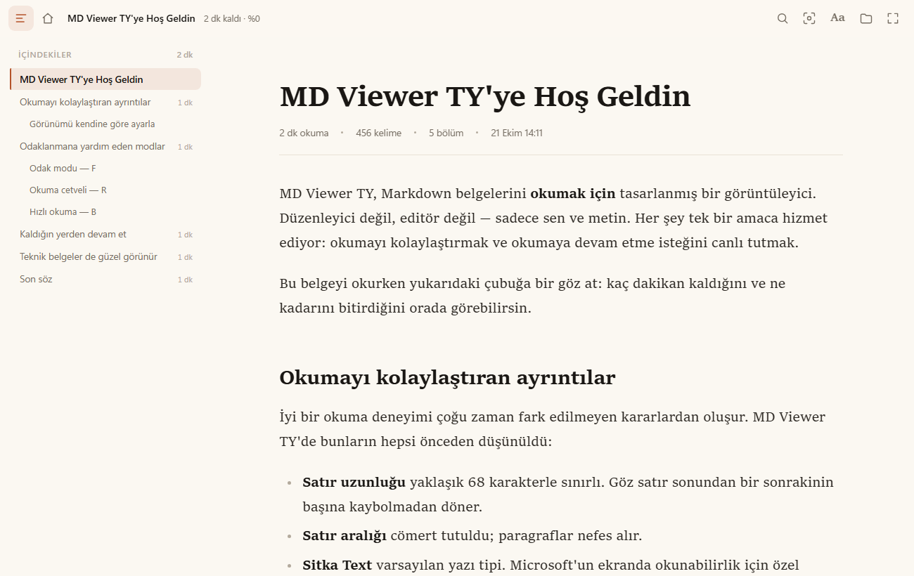
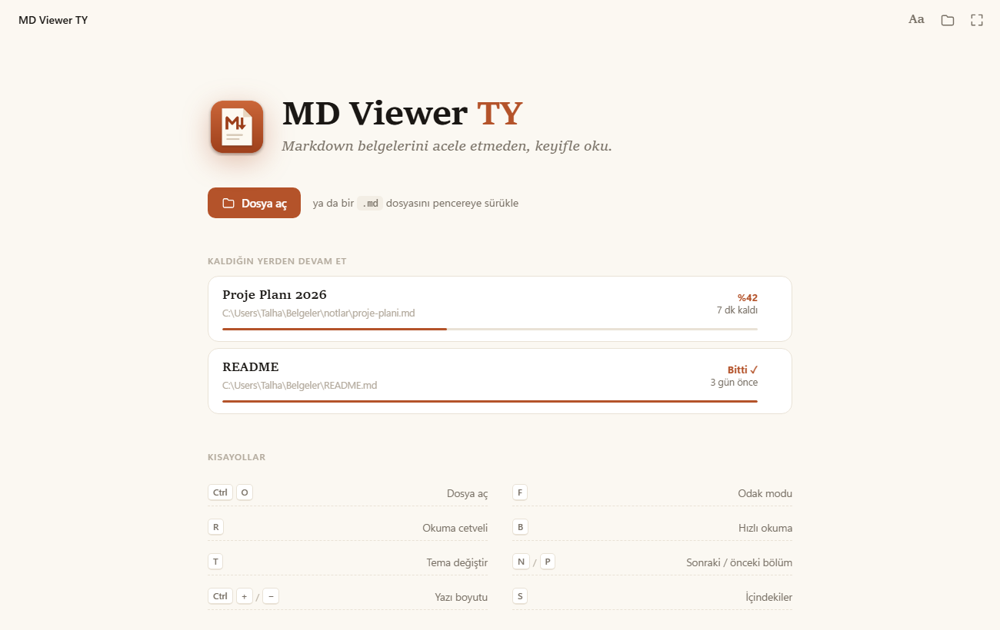
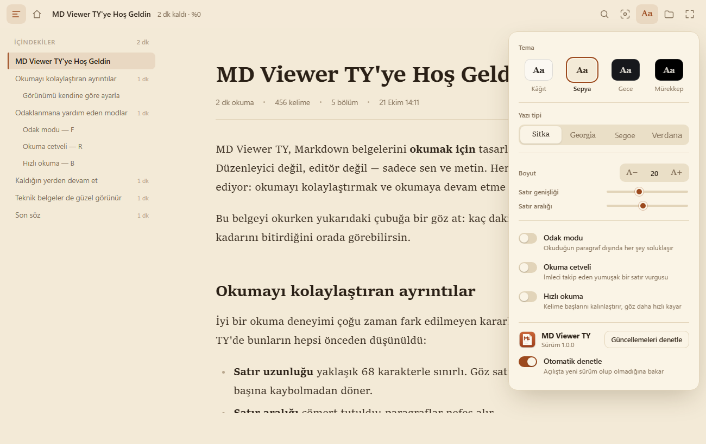
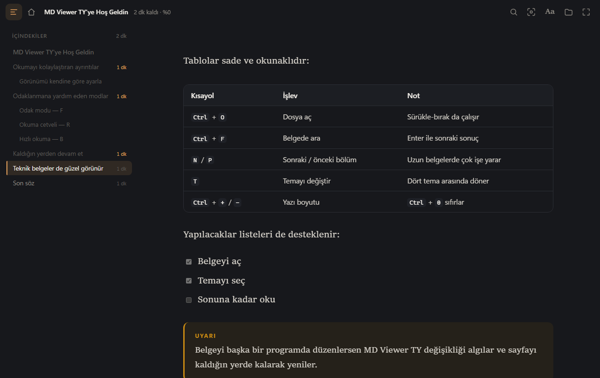
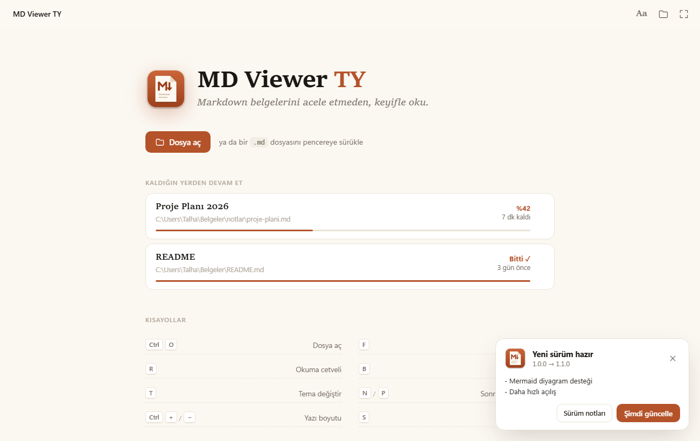

<p align="center">
  
</p>

<h1 align="center">MD Viewer TY</h1>

<p align="center">
  Windows için okuma odaklı Markdown görüntüleyici.<br>
  <code>.md</code> dosyalarını güzel göstermek, okumayı kolaylaştırmak ve sonuna kadar okuma isteği uyandırmak için.
</p>

<p align="center">
  <a href="https://github.com/mtalhayasar/md-viewer-ty/releases/latest"><b>⬇ En son sürümü indir</b></a>
</p>



## Özellikler

**Okumayı kolaylaştıran**
- Ekranda okunabilirlik için seçilmiş tipografi: ~68 karakterlik satır uzunluğu, geniş satır aralığı, Sitka Text
- 4 tema: Kâğıt, Sepya, Gece, Mürekkep (tam siyah) · 4 yazı tipi (Verdana disleksi dostu seçenek)
- Yazı boyutu, satır genişliği ve satır aralığı ayarı
- **Odak modu** (`F`): okuduğun paragraf dışındakiler soluklaşır
- **Okuma cetveli** (`R`): imleci takip eden satır vurgusu
- **Hızlı okuma** (`B`): kelime başlarını kalınlaştıran biyonik okuma

**Okuma isteğini artıran**
- Üst barda kalan süre ve yüzde: *"4 dk kaldı · %42"*
- Her bölümün okuma süresini gösteren, okunan bölümleri işaretleyen içindekiler
- **Kaldığın yerden devam**: her belgenin konumu hatırlanır, başlangıç ekranında ilerleme çubuğuyla listelenir
- Belgenin sonunda okuma özeti

**Pratik**
- Dosya değiştiğinde canlı yenileme (konum korunur), sürükle-bırak, belgede arama (`Ctrl+F`)
- Sözdizimi renklendirmeli ve kopyalanabilir kod blokları, tablolar, görev listeleri, dipnotlar
- GitHub not kutuları (`> [!NOTE]`, `[!TIP]`, `[!WARNING]` …), resim büyütme
- Belge içindeki yerel `.md` bağlantıları uygulamada, web bağlantıları tarayıcıda açılır
- Uygulama içinden tek tıkla güncelleme

| | |
|---|---|
|  |  |
|  |  |

## Kurulum

1. [Releases](https://github.com/mtalhayasar/md-viewer-ty/releases/latest) sayfasından `MDViewerTY-Setup-<sürüm>.exe` dosyasını indir.
2. Kurulumu çalıştır. Varsayılan olarak yalnızca senin kullanıcı hesabına kurulur, yönetici izni gerekmez.
3. Kurulum sırasında **".md dosyaları MD Viewer TY ile açılsın"** seçeneğiyle varsayılan program yapabilirsin.

> **Windows SmartScreen uyarısı:** Kurulum dosyası dijital olarak imzalı olmadığı için ilk çalıştırmada *"Windows bilgisayarınızı korudu"* uyarısı görülebilir. **Ek bilgi → Yine de çalıştır** ile devam edebilirsin. Dosyanın bütünlüğünü sürümdeki `SHA256SUMS.txt` ile doğrulayabilirsin:
> ```powershell
> Get-FileHash .\MDViewerTY-Setup-1.0.0.exe -Algorithm SHA256
> ```

**Varsayılan program hakkında:** Daha önce `.md` için başka bir program seçtiysen Windows bu seçimi korur ve değişikliği senin onaylamanı ister. Bu durumda kurulum *Ayarlar → Varsayılan uygulamalar* sayfasını açmayı önerir; orada `.md` için **MD Viewer TY**'yi seçmen yeterli. Programı kaldırınca önceki varsayılan geri yüklenir.

**Taşınabilir sürüm:** Kurulum istemiyorsan `MDViewerTY-<sürüm>-portable.zip` dosyasını açıp `MDViewerTY.exe`'yi çalıştırabilirsin (taşınabilir sürüm kendini güncellemez).

**Gereksinim:** Windows 10 (1809+) veya Windows 11, 64 bit. Microsoft Edge WebView2 Runtime (Windows 11'de hazır gelir; eksikse kurulum indirme sayfasını açar).

## Güncellemeler

Uygulama açılışta GitHub'daki son sürümü denetler (görünüm panelindeki **Otomatik denetle** ile kapatılabilir; **Güncellemeleri denetle** ile elle de bakılabilir). Yeni sürüm varsa **Şimdi güncelle** kurulum dosyasını indirir, `SHA256SUMS.txt` ile doğrular, sessizce kurar ve uygulamayı yeniden açar. Ayarların ve okuma konumların korunur.

## Kısayollar

| Kısayol | İşlev |
|---|---|
| `Ctrl` `O` | Dosya aç |
| `Ctrl` `F` | Belgede ara (`Enter` sonraki, `Shift+Enter` önceki) |
| `F` / `R` / `B` | Odak modu / Okuma cetveli / Hızlı okuma |
| `T` | Temayı değiştir |
| `S` | İçindekiler panelini aç/kapat |
| `N` / `P` | Sonraki / önceki bölüm |
| `Ctrl` `+` / `−` / `0` | Yazı boyutu büyüt / küçült / sıfırla |
| `F11` | Tam ekran |

## Geliştirme

```bat
python -m pip install -r requirements.txt
python -m mdviewer samples\hosgeldin.md
python -m unittest discover -s tests
```

| Yol | Görev |
|---|---|
| `mdviewer/app.py` | pywebview penceresi ve JavaScript köprüsü |
| `mdviewer/renderer.py` | Markdown → HTML, içindekiler, kelime sayısı, Pygments |
| `mdviewer/storage.py` | Ayarlar, son dosyalar, okuma konumları (`%APPDATA%\MD Viewer TY\state.json`) |
| `mdviewer/updater.py` | GitHub Releases ile güncelleme denetimi, indirme ve doğrulama |
| `mdviewer/ui/` | Arayüz (HTML/CSS/JS) |
| `installer/MDViewerTY.iss` | Inno Setup kurulum betiği |
| `tools/build.py` | Exe + kurulum + zip + SHA256SUMS üretir |
| `tools/make_icons.py` | İkonları üretir |

### Derleme

[Inno Setup 6](https://jrsoftware.org/isdl.php) kurulu olmalı.

```bat
build.bat
```

Çıktılar `dist\` altında: `MDViewerTY-Setup-<sürüm>.exe`, `MDViewerTY-<sürüm>-portable.zip`, `SHA256SUMS.txt`.

### Yeni sürüm yayınlama

1. `mdviewer/__init__.py` içindeki `__version__` değerini artır.
2. `CHANGELOG.md`'ye yeni sürümün bölümünü ekle.
3. Commit'le ve etiketi gönder:
   ```bash
   git tag v1.1.0
   git push origin main v1.1.0
   ```

GitHub Actions testleri çalıştırır, derler ve dosyalarla birlikte release'i yayımlar. Kurulu uygulamalar yeni sürümü otomatik bulur.

## Lisans

[MIT](LICENSE) © Talha Yaşar
